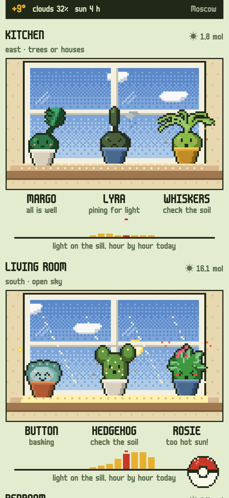
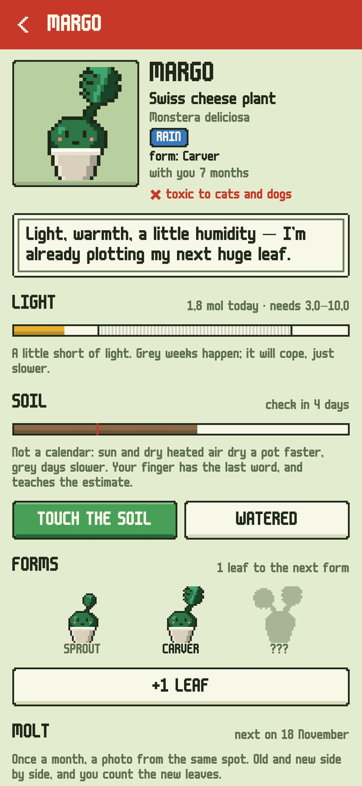
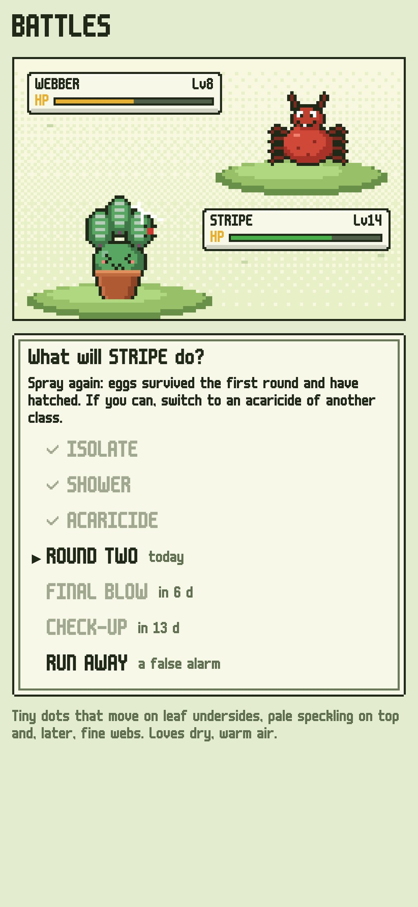
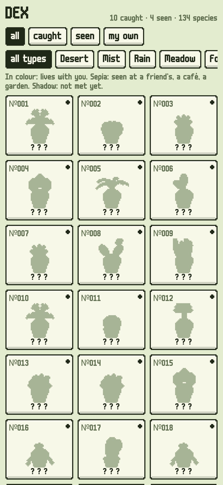
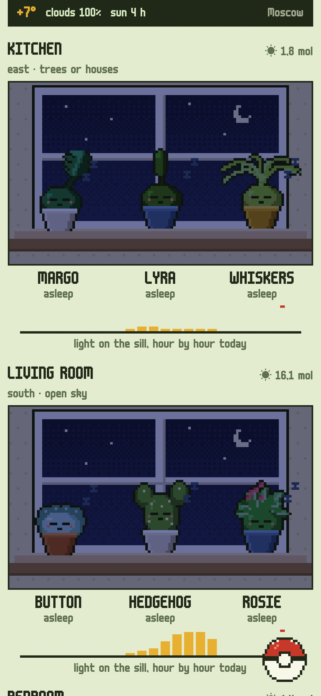

<div align="center">


# Rootlings

### A field guide to the spirits of your real houseplants.

*Every plant at your window has a spirit, a little pixel creature in a pot. Catch them all with the phone's camera, and they live by the real thing: the real sun and clouds over your town reach their sill hour by hour, they bask, pine for light, sleep through winter, change form as the plant really grows, hatch from cuttings and fight real pests with real treatment. No watering calendar: the app estimates how fast each pot dries and asks you to touch the soil. Free, no ads, no account.*

[](https://github.com/bigdevwhale/rootlings/actions/workflows/android.yml)
[](https://github.com/bigdevwhale/rootlings/releases/latest)


[](LICENSE)

**English** · [Русский](README.ru.md) · [Changelog](CHANGELOG.md)

    

</div>

---

## How it works

1. **Windows.** Add the windows your plants stand at. Press the phone's back to the glass and the compass tells you which way it looks, or pick by hand. Then say what's outside: open sky, trees, or a wall close by.
2. **Catching.** Take a photo with the phone's own camera. Then pick the species from a catalogue of 133 houseplants, or describe your own: its look, type, light, watering, humidity, winter rest and flowers. The spirit takes the green of your plant's leaves from the photo.
3. **The real sky.** With a town set, the light on every sill is worked out hour by hour from the real sun position and the real direct and diffuse radiation from Open-Meteo. When Open-Meteo is unreachable, the light is worked out from MET Norway's cloud cover instead. A south sill in November gets a fraction of June's light, and a plant a metre from the glass gets less than half. The panes show the real clouds, rain, snow and night.
4. **Soil, not a calendar.** Each pot dries at a pace set by:
   - its species;
   - its light;
   - the dry air of the heating season (five days in a row below +8° outside on average).

   When it's time, the spirit asks for a finger check. Your answer resets the estimate and teaches it how fast your pots really dry.
5. **Forms.** Count new leaves (or pads, or fronds) and take a monthly molt photo from the same spot, so before and after sit side by side. With enough growth and time, the spirit evolves into its next form.
6. **Nursery.** A cutting in water or soil is an egg, and when the roots show, a spirit hatches with its ancestry. You can give it away as a text code; the friend's app takes it in with its lineage.
7. **Battles.** Webs, specks, sticky leaves, gnats? Pick the symptoms and fight the pest with the real treatment, move by move. There are 12 pests, from spider mites to root rot and sunburn, and the repeat sprays unlock on their real days.
8. **Dex and herbarium.** The dex shows your species in colour, the ones seen at a friend's or a café in sepia, and the rest as shadows. It also keeps the pests you beat, and the herbarium keeps plants that died as pressed pages. For a trip away, there's a note for whoever waters.

## Privacy

No account, no ads, no analytics. Plants, photos and notes stay on the phone. The only network requests are the town search and the weather: the chosen town's coordinates go to Open-Meteo (or MET Norway), nothing else.

## Building

```bash
./gradlew testDebugUnitTest assembleDebug              # app.rootlings.dev, next to a real install
./gradlew assembleDebug -Pdemo                         # app.rootlings.demo, three windows and half a year of care
./gradlew testDebugUnitTest -Prender --tests '*RenderArt*' && python tools/shots.py   # screenshots and sprite sheets
python -I tools/check_content.py                       # validates the catalogue, pests, moves and lines
python tools/res.py                                    # the string resources, EN and RU
python tools/icon.py                                   # the launcher icon and the logo
```

Built with Kotlin, Jetpack Compose, Room, DataStore and WorkManager. Every picture is pixel art drawn in code: 25 plant shapes in three forms each, faces and effects for 13 moods, 12 pests, and the windows with their real sky. The content is TSV in `app/src/main/assets/content` (format in [docs/CONTENT.md](docs/CONTENT.md)).

## License

[MIT](LICENSE). Font: m6x11 by Daniel Linssen, Cyrillic by Natto Games (free with attribution). Weather: [Open-Meteo.com](https://open-meteo.com) and [MET Norway](https://api.met.no) (CC BY 4.0). Care data is general advice; every home is different.
