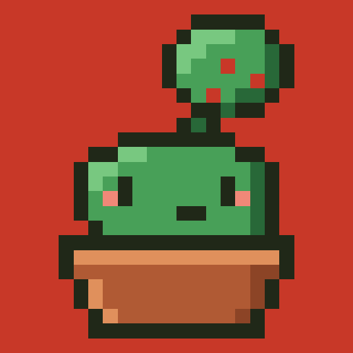
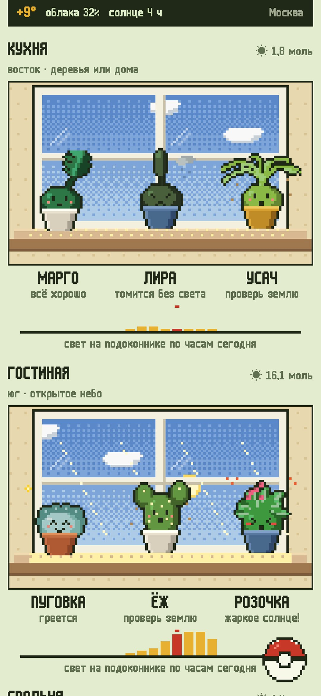
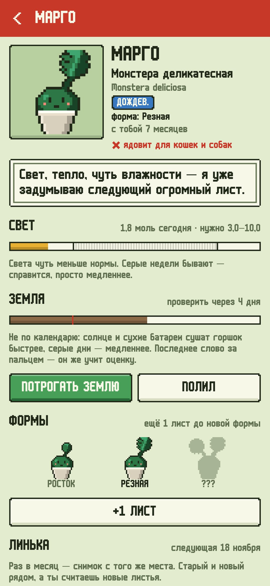
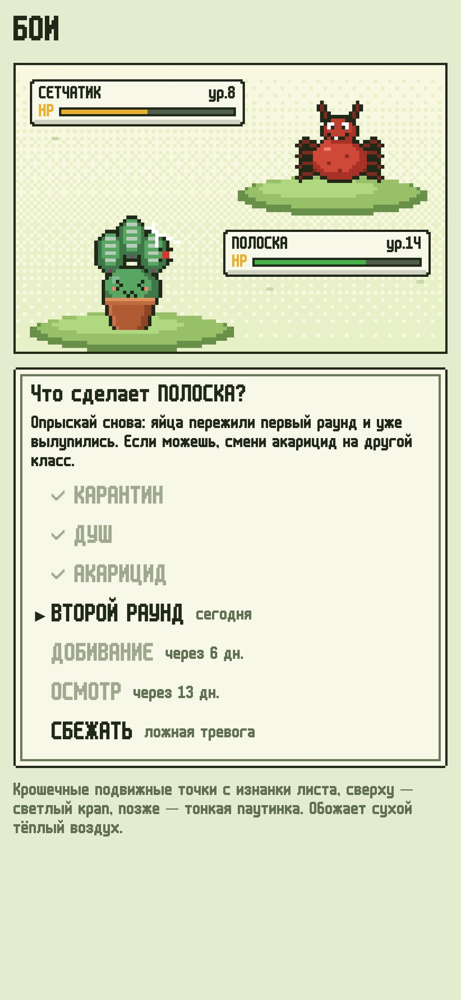
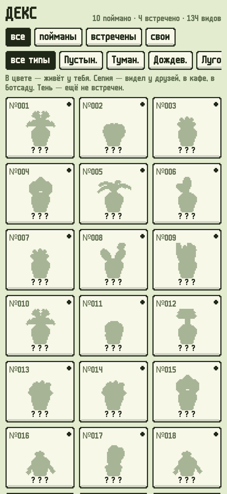
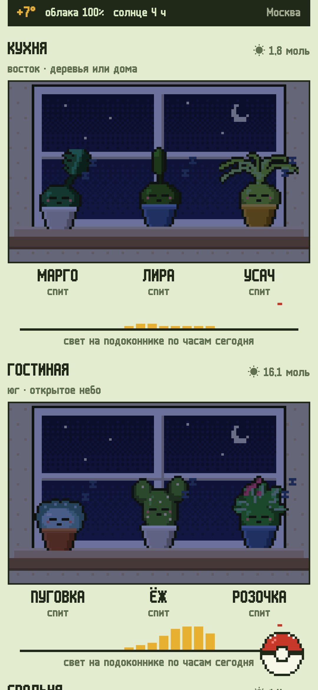

<div align="center">



# Корешки

### Полевой определитель духов твоих настоящих комнатных растений.

*У каждого растения на твоём окне есть дух — маленькое пиксельное существо в горшке. Поймай их всех камерой телефона, и они будут жить по-настоящему. Настоящее солнце и облака над твоим городом доходят до их подоконника час за часом. Духи греются, томятся без света, зимуют, меняют форму, когда растение действительно растёт, вылупляются из черенков и сражаются с настоящими вредителями настоящим лечением. Календаря полива нет: приложение прикидывает, как быстро сохнет каждый горшок, и просит потрогать землю. Бесплатно, без рекламы и аккаунта.*

[](https://github.com/bigdevwhale/rootlings/actions/workflows/android.yml)
[](https://github.com/bigdevwhale/rootlings/releases/latest)


[](LICENSE)

[English](README.md) · **Русский** · [Изменения](CHANGELOG.md)

    

</div>

---

## Как это устроено

1. **Окна.** Добавь окна, у которых стоят растения. Прижми телефон спиной к стеклу, и компас скажет, куда смотрит окно, или выбери направление сам. Потом отметь, что снаружи: открытое небо, деревья или близкая стена.
2. **Поимка.** Сними растение системной камерой. Потом выбери вид из каталога на 133 комнатных растения или опиши свой вручную: облик, тип, свет, полив, влажность, зимовку и цветы. Дух берёт со снимка зелень именно твоих листьев.
3. **Настоящее небо.** Если выбран город, свет на каждом подоконнике считается час за часом по настоящему положению солнца и настоящей прямой и рассеянной радиации из Open-Meteo. Если Open-Meteo недоступен, свет считается по облачности MET Norway. Южное окно в ноябре получает малую долю июньского света, а растение в метре от стекла — меньше половины. В стёклах видны настоящие облака, дождь, снег и ночь.
4. **Земля, а не календарь.** Темп, в котором сохнет горшок, зависит от трёх вещей:
   - вида растения;
   - его света;
   - сухого воздуха отопительного сезона (пять дней подряд снаружи в среднем ниже +8°).

   Когда пора, дух просит проверить землю пальцем. Твой ответ сбрасывает оценку и учит её, как быстро на самом деле сохнут твои горшки.
5. **Формы.** Отмечай новые листья (лепёшки, вайи) и раз в месяц снимай линьку с того же места, чтобы «было» и «стало» лежали рядом. Когда хватит роста и времени, дух эволюционирует в следующую форму.
6. **Ясли.** Черенок в воде или в земле — это яйцо. Когда покажутся корни, вылупится дух с родословной. Его можно подарить текстовым кодом, и у друга он появится вместе с родословной.
7. **Бои.** Паутинка, точки, липкие листья, мошки? Отметь симптомы и сразись с вредителем настоящим лечением, ход за ходом. Вредителей 12, от паутинного клеща до корневой гнили и ожога. Повторные обработки открываются в свои настоящие дни.
8. **Декс и гербарий.** В дексе твои виды в цвете, встреченные у друзей или в кафе — сепией, остальные — тенью. Там же хранятся побеждённые вредители, а погибшие растения лежат в гербарии засушенными страницами. На время отъезда есть записка для того, кто поливает.

## Приватность

Без аккаунта, рекламы и аналитики. Растения, снимки и записи остаются в телефоне. В сеть уходят только поиск города и погода: координаты выбранного города — в Open-Meteo (или MET Norway), больше ничего.

## Сборка

```bash
./gradlew testDebugUnitTest assembleDebug              # app.rootlings.dev рядом с настоящей установкой
./gradlew assembleDebug -Pdemo                         # app.rootlings.demo: три окна и полгода ухода
./gradlew testDebugUnitTest -Prender --tests '*RenderArt*' && python tools/shots.py   # скриншоты и листы спрайтов
python -I tools/check_content.py                       # проверка каталога, вредителей, ходов и реплик
python tools/res.py                                    # строки EN и RU
python tools/icon.py                                   # иконка и логотип
```

Kotlin, Jetpack Compose, Room, DataStore, WorkManager. Вся графика — пиксель-арт, нарисованный в коде: 25 форм растений по три стадии, лица и эффекты для 13 настроений, 12 вредителей и окна с настоящим небом. Контент лежит в TSV в `app/src/main/assets/content` (формат в [docs/CONTENT.md](docs/CONTENT.md)).

## Лицензия

[MIT](LICENSE). Шрифт: m6x11 — Daniel Linssen, кириллица — Natto Games (свободно с указанием автора). Погода: [Open-Meteo.com](https://open-meteo.com) и [MET Norway](https://api.met.no) (CC BY 4.0). Советы по уходу общие — каждый дом свой.
